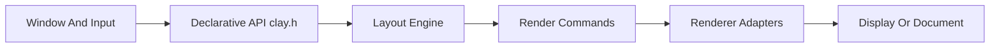

# nicbarker/clay

> Single-header C library that computes 2D interface layouts in microseconds.

## The problem
Computing an interface layout (flexbox, scrolling, text) without depending on a rendering engine or an allocator.

## What it actually does
`clay.h` (about 4.8k lines, no dependencies): you declare the hierarchy with the `CLAY()` macro, then `Clay_EndLayout` returns a sorted list of render commands (rectangle, text, image, border, clipping) to draw with any engine. Static memory arena, transitions, floating elements, pointer and scrolling, built-in debugging tools. Renderers provided for SDL, GLES3, Cairo, terminal, HTML; a 15 KB WASM target.

## How it is wired


## Trying it
```C
#define CLAY_IMPLEMENTATION
#include "../../clay.h"
Clay_BeginLayout();
Clay_RenderCommandArray renderCommands = Clay_EndLayout(deltaTime);
```

## Cost and gotchas
Free (Zlib). No multithreading; text measurement must be supplied and must be fast; IDs must be stable for transitions.

## What it is not
Not a complete toolkit: no window, no input, no rendering.

## Alternatives
No alternative named in the README (Go ports and Odin/Rust bindings are mentioned).

## For you
Off-topic for data/AI: it is a C library for computing interface layouts, useful only for low-level interface development. To ignore for your field.
