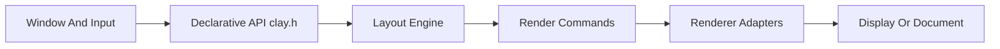

# nicbarker/clay

> Bibliothèque C en un seul en-tête qui calcule des mises en page d'interfaces 2D en microsecondes.

## Le problème
Calculer le layout d'une interface (flexbox, défilement, texte) sans dépendre d'un moteur de rendu ni d'un allocateur.

## Ce que ça fait vraiment
`clay.h` (≈4,8k lignes, aucune dépendance) : on déclare la hiérarchie avec la macro `CLAY()`, puis `Clay_EndLayout` renvoie une liste triée de commandes de rendu (rectangle, texte, image, bordure, découpe) à dessiner avec n'importe quel moteur. Arène mémoire statique, transitions, éléments flottants, pointeur et défilement, outils de débogage intégrés. Rendus fournis pour SDL, GLES3, Cairo, terminal, HTML ; cible WASM de 15 ko.

## Comment c'est branché


## Essayer
```C
#define CLAY_IMPLEMENTATION
#include "../../clay.h"
Clay_BeginLayout();
Clay_RenderCommandArray renderCommands = Clay_EndLayout(deltaTime);
```

## Coût et pièges
Gratuit (Zlib). Aucun multithreading ; la mesure de texte est à fournir et doit être rapide ; les IDs doivent être stables pour les transitions.

## Ce que ce n'est pas
Pas un toolkit complet : ni fenêtre, ni entrées, ni rendu.

## Alternatives
Aucune alternative nommée dans le README (des portages Go et des liaisons Odin/Rust sont cités).

## Pour toi
Hors sujet pour la data/IA : à ignorer.

