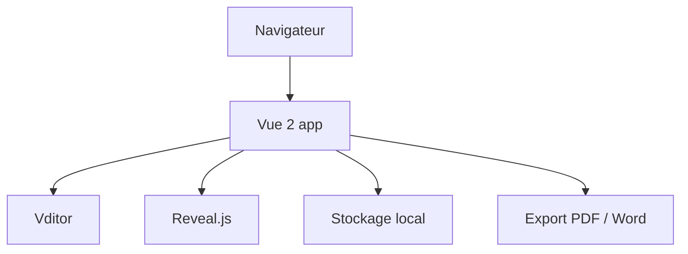

# nicejade/markdown-online-editor

> Online Markdown editor (Vue 2 and Vditor) with diagrams, ECharts, slide preview and exports.

## The problem
Online Markdown editors lack advanced features or charge for them.

## What it actually does
WYSIWYG editor, instant rendering or split screen: flowcharts, Gantt, sequence, ECharts, music scores, PPT preview via Reveal.js, HTML-to-Markdown paste, PDF/PNG/JPEG/Word export, local saving. Documentation in Chinese.

## How it is wired

Diagram based on the README, no diagram provided.

## Trying it
```bash
docker run -d -p 8866:80 nicejade/markdown-online-editor:latest
yarn
yarn start
```

## Cost and gotchas
Free. Node 16 to 17 required for development.

## What it is not
Not collaborative: storage is local to the browser.

## Alternatives
Vditor (the project's base): the Markdown editor this one is built on, usable directly if you only want the component without this application.

## For you
Ignore: one more editor, unrelated to data/AI/MLOps.
