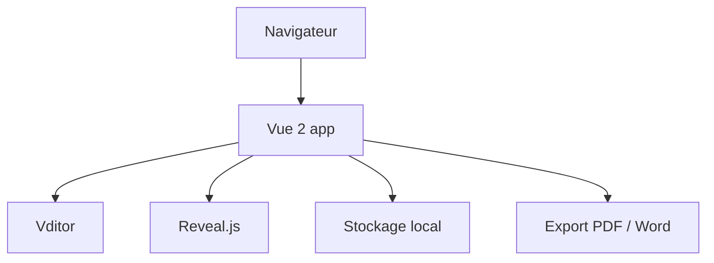

# nicejade/markdown-online-editor

> Éditeur Markdown en ligne (Vue 2 et Vditor) avec diagrammes, ECharts, aperçu de diapositives et exports.

## Le problème
Les éditeurs Markdown en ligne manquent de fonctions avancées ou les font payer.

## Ce que ça fait vraiment
Éditeur WYSIWYG, rendu instantané ou écran partagé : flux, Gantt, séquence, ECharts, partitions, aperçu PPT via Reveal.js, collage HTML vers Markdown, export PDF/PNG/JPEG/Word, sauvegarde locale. Documentation en chinois.

## Comment c'est branché

Schéma d'après le README, pas de diagramme fourni.

## Essayer
```bash
docker run -d -p 8866:80 nicejade/markdown-online-editor:latest
yarn
yarn start
```

## Coût et pièges
Gratuit. Node 16 à 17 requis en développement.

## Ce que ce n'est pas
Pas collaboratif : stockage local au navigateur.

## Alternatives
Vditor (la base du projet) : l'éditeur Markdown sur lequel celui-ci est construit, utilisable directement si tu veux seulement le composant sans cette application.

## Pour toi
Ignorer : un éditeur de plus, sans lien avec data/IA/MLOps.

