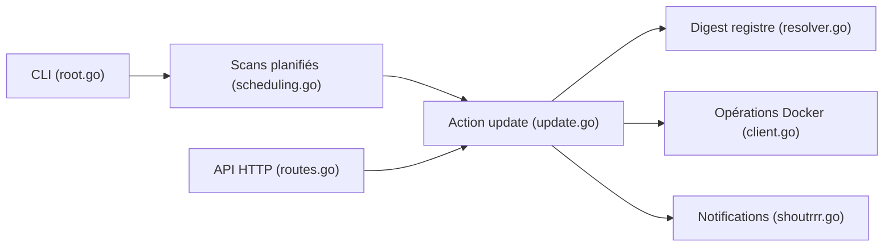

# nicholas-fedor/watchtower

> Container that automatically updates running Docker images; for homelabs and local dev.

## The problem
Keeping containers up to date means pulling the image, stopping the old container and restarting it with the same options.

## What it actually does
It discovers the monitored containers, compares registry digests (or Git revisions), then replaces outdated containers while keeping their configuration. Scheduled or one-off scans from the CLI; HTTP API (update, check, health, metrics, history); notifications via Shoutrrr, lifecycle hooks, dependency ordering, filters, registry authentication.

## How it is wired


## Trying it
```bash
docker run --detach \
    --name watchtower \
    --volume /var/run/docker.sock:/var/run/docker.sock \
    nickfedor/watchtower
```

## Cost and gotchas
Free; requires access to the Docker socket. Tested with Docker API 1.43+. The author does not recommend using it in commercial or production environments.

## What it is not
Not a controlled deployment tool: an automatic image update can break a service. The README is short; the full documentation is external.

## Alternatives
Kubernetes with CI/CD (for example Talos Linux with FluxCD, cited by the README) for production.

## For you
Handy on a personal server hosting your ML tools; for production services or versioned models, an implicit update is a risk, so prefer an explicit pipeline.
