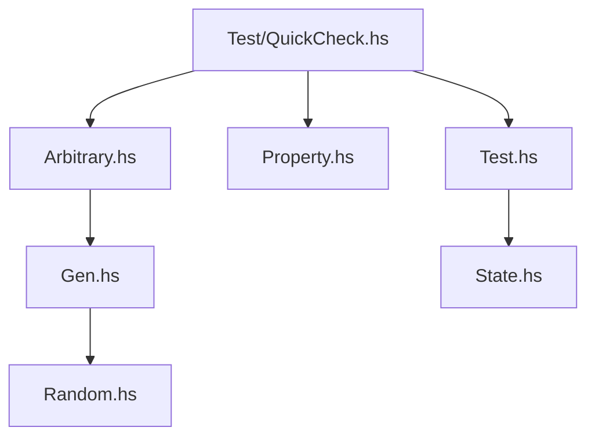

# nick8325/quickcheck

> Haskell library for random property-based testing, for Haskell developers.

## The problem
Hand-written tests only cover the cases you thought of.

## What it actually does
The README is very short: add `QuickCheck` to the dependencies to use it in tests or at the REPL. From the code: Arbitrary and Gen produce random values, Property ties them to properties, and Test.hs runs the trials with a counterexample shrinker.

## How it is wired

## Trying it
No documented command, other than adding `QuickCheck` to the dependencies. A make-hugs script exists for Hugs.

## Cost and gotchas
Free. Requires Haskell. The catalog reports a license that is present but unidentified: to be checked.

## What it is not
Not a classic unit-testing tool: it generates random cases. The README does not document the API.

## Alternatives
quickcheck-instances, a companion package that adds instances for the Haskell Platform types.

## For you
Watch: useful if you write Haskell; otherwise, the idea of property-based testing exists in other languages.
