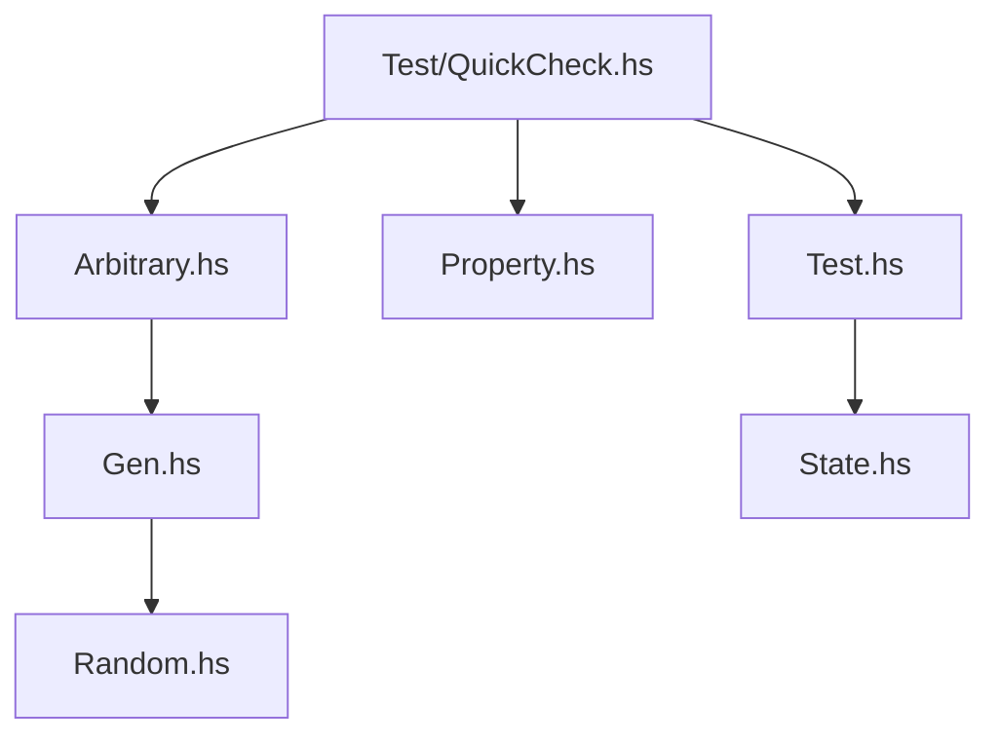

# nick8325/quickcheck

> Bibliothèque Haskell de tests aléatoires de propriétés, pour développeurs Haskell.

## Le problème
Les tests écrits à la main ne couvrent que les cas auxquels on a pensé.

## Ce que ça fait vraiment
Le README est très court : ajouter `QuickCheck` aux dépendances pour l'utiliser en test ou au REPL. D'après le code : Arbitrary et Gen produisent des valeurs aléatoires, Property les relie aux propriétés, et Test.hs lance les essais avec un réducteur de contre-exemples.

## Comment c'est branché

## Essayer
Aucune commande documentée, hors l'ajout de `QuickCheck` aux dépendances. Un script make-hugs existe pour Hugs.

## Coût et pièges
Gratuit. Il faut Haskell. Le catalogue signale une licence présente mais non identifiée : à vérifier.

## Ce que ce n'est pas
Pas un outil de tests unitaires classique : il génère des cas aléatoires. Le README ne documente pas l'API.

## Alternatives
quickcheck-instances, paquet compagnon qui ajoute des instances pour les types de la Haskell Platform.

## Pour toi
Surveiller : sert si tu écris du Haskell ; sinon, l'idée de tests à propriétés existe dans d'autres langages.

