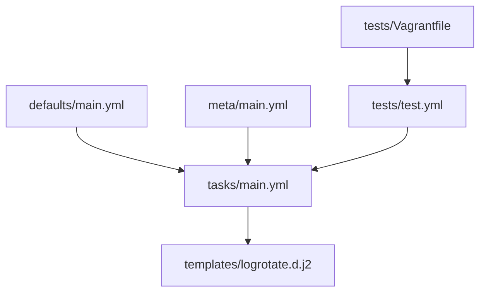

# nickhammond/ansible-logrotate

> Ansible role that installs logrotate and generates log rotation rules.

## The problem
Configuring logrotate by hand on every server is repetitive and prone to drift.

## What it actually does
The `logrotate_scripts` variables (name, path, options, scripts) feed tasks that render the `logrotate.d.j2` template. A test playbook runs through Vagrant.

## How it is wired


## Trying it
```bash
cd tests
vagrant up --provision
```

## Cost and gotchas
Free. Ansible required (outside the list). Last push in 2018.

## What it is not
Not a log monitoring tool: it only configures rotation.

## Alternatives
No alternative named in the README.

## For you
Ignore: old and very narrow role; write it yourself in ten lines if the need arises.
