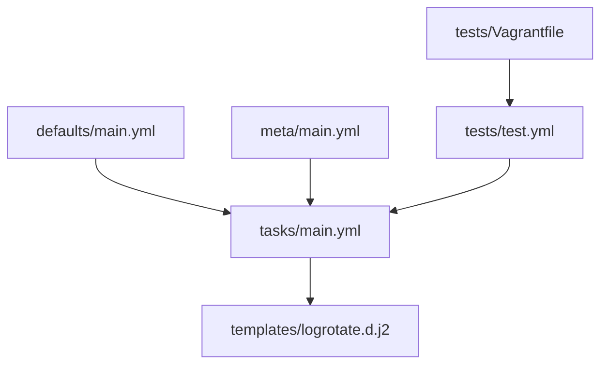

# nickhammond/ansible-logrotate

> Rôle Ansible qui installe logrotate et génère des règles de rotation de journaux.

## Le problème
Configurer logrotate à la main sur chaque serveur est répétitif et source d'écarts.

## Ce que ça fait vraiment
Les variables `logrotate_scripts` (nom, chemin, options, scripts) alimentent des tâches qui rendent le modèle `logrotate.d.j2`. Un playbook de test tourne via Vagrant.

## Comment c'est branché


## Essayer
```bash
cd tests
vagrant up --provision
```

## Coût et pièges
Gratuit. Ansible requis (hors liste). Dernier push en 2018.

## Ce que ce n'est pas
Pas un outil de supervision des journaux : il ne configure que la rotation.

## Alternatives
Aucune alternative nommée dans le README.

## Pour toi
À ignorer : rôle ancien et très étroit ; à écrire toi-même en dix lignes si le besoin se présente.

