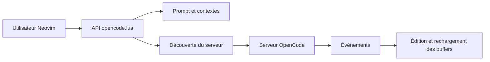

# nickjvandyke/opencode.nvim

> Neovim plugin that connects the editor to an OpenCode server to pair-program with AI.

## The problem
Using a coding agent from a terminal forces you to copy selections, diagnostics and open files by hand, and to leave the editor.

## What it actually does
Connects to an OpenCode server (existing or launched by the plugin) and injects editor context through placeholders (`@this`, `@buffer`, `@diagnostics`, `@quickfix`…). Offers ask, select, prompt, operator and command, relays OpenCode's SSE events as autocmds, reloads modified buffers and shows edit requests as `:diffpatch`.

## How it is wired


## Trying it
```bash
# Dans la config Neovim :
# vim.pack.add({ { src = "https://github.com/nickjvandyke/opencode.nvim" } })
# puis :checkhealth opencode
```

## Cost and gotchas
Free; requires OpenCode and its own model providers. Event payloads follow the OpenCode schema, with no stability guarantee. The default branch targets OpenCode v2.

## What it is not
Not an autonomous agent: it provides context and connection, and the developer stays in control.

## Alternatives
- No alternative named in the README.

## For you
Ignore unless you already use Neovim and OpenCode: it is an editor integration, unrelated to data or MLOps work.
