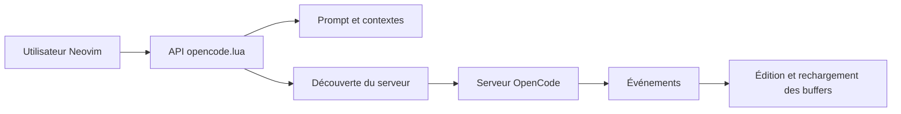

# nickjvandyke/opencode.nvim

> Plugin Neovim qui relie l'éditeur à un serveur OpenCode pour travailler en binôme avec l'IA.

## Le problème
Utiliser un agent de code depuis un terminal oblige à recopier sélections, diagnostics et fichiers ouverts, et à quitter l'éditeur.

## Ce que ça fait vraiment
Se connecte à un serveur OpenCode (existant ou lancé par le plugin) et injecte le contexte de l'éditeur via des placeholders (`@this`, `@buffer`, `@diagnostics`, `@quickfix`…). Propose ask, select, prompt, operator et command, retransmet les événements SSE d'OpenCode en autocmds, recharge les buffers modifiés et affiche les demandes d'édition en `:diffpatch`.

## Comment c'est branché


## Essayer
```bash
# Dans la config Neovim :
# vim.pack.add({ { src = "https://github.com/nickjvandyke/opencode.nvim" } })
# puis :checkhealth opencode
```

## Coût et pièges
Gratuit ; requiert OpenCode et ses propres fournisseurs de modèles. Les charges utiles d'événements suivent le schéma OpenCode, sans garantie de stabilité. La branche par défaut cible OpenCode v2.

## Ce que ce n'est pas
Pas un agent autonome : il fournit contexte et connexion, et le développeur reste aux commandes.

## Alternatives
- Aucune alternative nommée dans le README.

## Pour toi
À ignorer sauf si tu utilises déjà Neovim et OpenCode : c'est une intégration d'éditeur, sans rapport avec un travail data ou MLOps.

