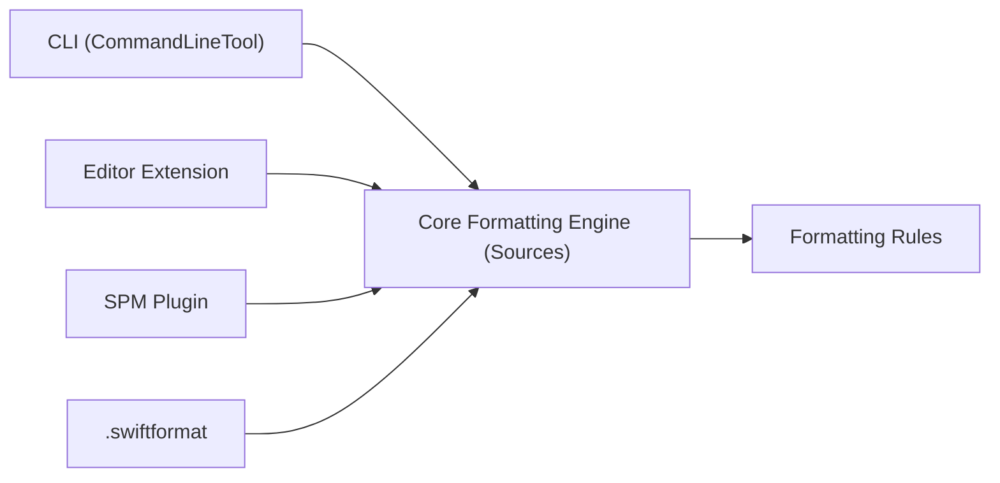

# nicklockwood/SwiftFormat

> Library and command-line tool that reformat Swift code according to configurable style rules.

## The problem
Teams argue over code style, and enforcing it by hand is tedious and error-prone.

## What it actually does
Reformats Swift code beyond whitespace: adding or removing `self`, redundant parentheses, more than 50 rules that can be enabled or disabled. Configuration through `.swiftformat` or options. `--lint` mode for CI, Xcode extension, SwiftPM plugin, pre-commit hook, Docker image, formatting of Swift blocks in Markdown files.

## How it is wired


## Trying it
```bash
brew install swiftformat
swiftformat --infer-options "/path/to/your/code/"
swiftformat .
swiftformat --lint .
```

## Cost and gotchas
Free. `swiftformat .` overwrites files: commit to git first. Some rules can break compilation (list of known issues in the README).

## What it is not
It is not a quality linter: SwiftLint detects, SwiftFormat fixes.

## Alternatives
SwiftLint, cited in the FAQ as a complementary tool.

## For you
Ignore unless you write Swift: reserved for Apple development, with no use in a data, AI or MLOps flow.
