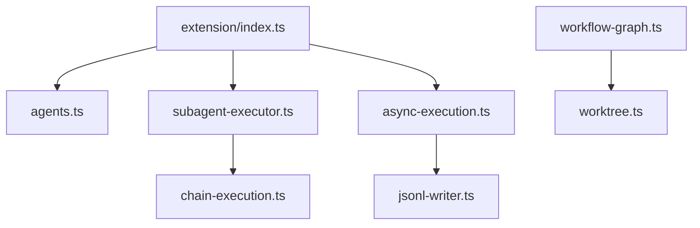

# nicobailon/pi-subagents

> Extension for the Pi agent that delegates tasks to specialized subagents, for review, scouting or implementation.

## The problem
A single coding agent that reads, writes and reviews its own work lacks perspective and saturates its context.

## What it actually does
It adds the `subagent` tool to Pi: the parent launches child sessions in the foreground or background, alone, chained or in parallel. Seven agents are shipped (scout, researcher, evidence-auditor, worker, reviewer, oracle, delegate), defined in Markdown. It handles saved chains, isolated git worktrees, a launch limiter and background task tracking.

## How it is wired


## Trying it
```bash
pi install npm:pi-subagents
/subagents-doctor
```

## Cost and gotchas
The extension is free, but it requires Pi 1.2.0 or later; each subagent consumes the model configured in Pi, at your expense. `researcher` and `evidence-auditor` require pi-web-access. The full tool is not loaded until delegation is allowed.

## What it is not
It is not an autonomous agent: nothing launches without your request. It does not work outside the Pi ecosystem.

## Alternatives
No alternative named in the README.

## For you
Keep an eye on it: if you work with Pi, parallel review by distinct agents is a useful practice to test; otherwise it is of no interest.
