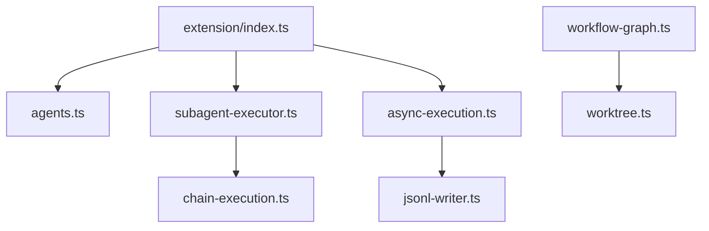

# nicobailon/pi-subagents

> Extension de l'agent Pi qui délègue des tâches à des sous-agents spécialisés, pour revue, repérage ou implémentation.

## Le problème
Un seul agent de code qui lit, écrit et relit son propre travail manque de recul et sature son contexte.

## Ce que ça fait vraiment
Elle ajoute l'outil `subagent` à Pi : le parent lance des sessions enfants au premier plan ou en arrière-plan, seuls, en chaîne ou en parallèle. Sept agents sont livrés (scout, researcher, evidence-auditor, worker, reviewer, oracle, delegate), définis en Markdown. Elle gère les chaînes enregistrées, des worktrees git isolés, un limiteur de lancements et le suivi des tâches de fond.

## Comment c'est branché


## Essayer
```bash
pi install npm:pi-subagents
/subagents-doctor
```

## Coût et pièges
L'extension est gratuite, mais elle exige Pi 1.2.0 ou plus ; chaque sous-agent consomme le modèle configuré dans Pi, à ta charge. `researcher` et `evidence-auditor` demandent pi-web-access. L'outil complet n'est pas chargé tant que la délégation n'est pas autorisée.

## Ce que ce n'est pas
Ce n'est pas un agent autonome : rien ne se lance sans ta demande. Elle ne marche pas hors de l'écosystème Pi.

## Alternatives
Aucune alternative nommée dans le README.

## Pour toi
À surveiller : si tu travailles avec Pi, la revue en parallèle par des agents distincts est une pratique utile à tester, sinon elle n'a pas d'intérêt.

