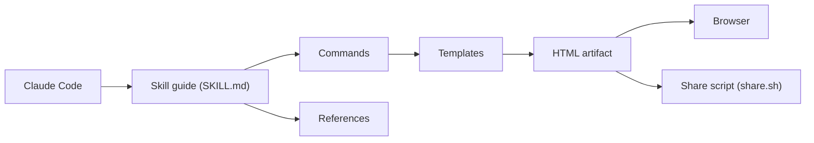

# nicobailon/visual-explainer

> Agent skill that replaces ASCII diagrams and terminal tables with readable HTML pages.

## The problem
Coding agents draw in ASCII and in tables of vertical bars that become unreadable as soon as the subject exceeds three boxes or fifteen comparison rows.

## What it actually does
- Generates a standalone HTML page (animated SVG diagrams, light and dark themes) opened in the browser.
- Commands: `/generate-web-diagram`, `/diff-review`, `/plan-review`, `/project-recap`, `/compare`, `/fact-check`, slides, MP4 video.
- Works as a Claude Code plugin, a Codex skill, Cursor, OpenCode, Pi, or a local MCP server over stdio.
- Output goes to `~/.agent/diagrams/`; static PPTX export on a best-effort basis.

## How it is wired


## Trying it
```shell
/plugin marketplace add nicobailon/visual-explainer
/plugin install visual-explainer@visual-explainer-marketplace
```
Then ask: "draw a diagram of our authentication flow".

## Cost and gotchas
Free, no build for normal use. Video requires ffmpeg, Chrome and `playwright-core`; narration needs a text-to-speech API key. Sharing via `share.sh` to Vercel comes from the architecture, not confirmed in the part of the README read (truncated).

## What it is not
Not an application: a set of instructions and templates whose quality depends on the model. Automatic browser opening depends on the harness and the sandbox. PPTX export has no animations.

## Alternatives
No alternative named in the README read.

## For you
Adopt: your diff reviews, architecture diagrams and tables become readable at zero cost, and the skill installs with one command in Claude Code.
