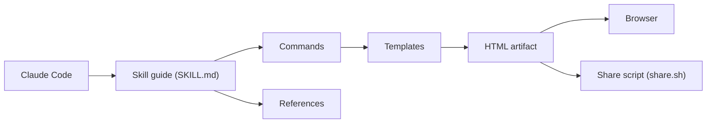

# nicobailon/visual-explainer

> Skill d'agent qui remplace les schémas ASCII et tableaux du terminal par des pages HTML lisibles.

## Le problème
Les agents de code dessinent en ASCII et en tableaux de barres verticales illisibles dès que le sujet dépasse trois boîtes ou quinze lignes de comparaison.

## Ce que ça fait vraiment
- Génère une page HTML autonome (schémas SVG animés, thèmes clair et sombre) ouverte dans le navigateur.
- Commandes : `/generate-web-diagram`, `/diff-review`, `/plan-review`, `/project-recap`, `/compare`, `/fact-check`, slides, vidéo MP4.
- Fonctionne comme plugin Claude Code, skill Codex, Cursor, OpenCode, Pi, ou serveur MCP local en stdio.
- Sortie dans `~/.agent/diagrams/` ; export PPTX statique au mieux.

## Comment c'est branché


## Essayer
```shell
/plugin marketplace add nicobailon/visual-explainer
/plugin install visual-explainer@visual-explainer-marketplace
```
Puis demander : « draw a diagram of our authentication flow ».

## Coût et pièges
Gratuit, sans build pour l'usage normal. La vidéo exige ffmpeg, Chrome et `playwright-core` ; la narration demande une clé d'API de synthèse vocale. Le partage par `share.sh` vers Vercel vient de l'architecture, non confirmé dans la partie du README lue (tronquée).

## Ce que ce n'est pas
Pas une application : un jeu d'instructions et de gabarits dont la qualité dépend du modèle. L'ouverture automatique du navigateur dépend du harnais et du bac à sable. Export PPTX sans animations.

## Alternatives
Aucune alternative nommée dans le README lu.

## Pour toi
À adopter : tes revues de diff, schémas d'architecture et tableaux deviennent lisibles à coût nul, et le skill se pose en une commande dans Claude Code.

