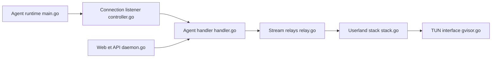

# nicocha30/ligolo-ng

> Network tunneling tool using a TUN interface, for authorized penetration testers who connect networks.

## The problem
Reaching a remote network through a SOCKS proxy or TCP/UDP redirectors requires proxychains and slows tools down. Ligolo-ng replaces this with a virtual network interface.

## What it actually does
An agent establishes a reverse TCP/TLS connection to a proxy. The proxy creates a TUN interface; a userland network stack (gVisor) translates packets into real connections on the agent side. The agent does not need administrator rights, the proxy does (TUN creation). Version 0.8: API, multi-operator web interface, configuration file, daemon mode, automatic routes (Windows, Linux, macOS, BSD). Advertised throughput: over 100 Mbit/s.

## How it is wired


## Trying it
```bash
# Aucune commande dans le README : renvoie vers la documentation en ligne
# (Setup/Quickstart) de Ligolo-ng.
```

## Cost and gotchas
Free. The proxy must be able to create a TUN interface (elevated rights). Without privileges on the agent side, no raw packets: a SYN scan becomes a TCP connect(), hence false positives (the README recommends `--unprivileged` or `-PE` with nmap).

## What it is not
Not an enterprise VPN nor a defensive security product: it is a penetration testing tool. To be used only on systems for which you hold written authorization of access. mTLS is still on the to-do list.

## Alternatives
- Chisel: TCP/UDP tunnel, mentioned by the README, but without a TUN interface.
- Ligolo (original version): same author, ancestor cited in the comparison.
- Meterpreter: also cited; broader platform, different tunneling mechanism.

## For you
Worth watching: useful only if you do authorized penetration testing or red teaming; without that need, no direct data/AI/MLOps use.
