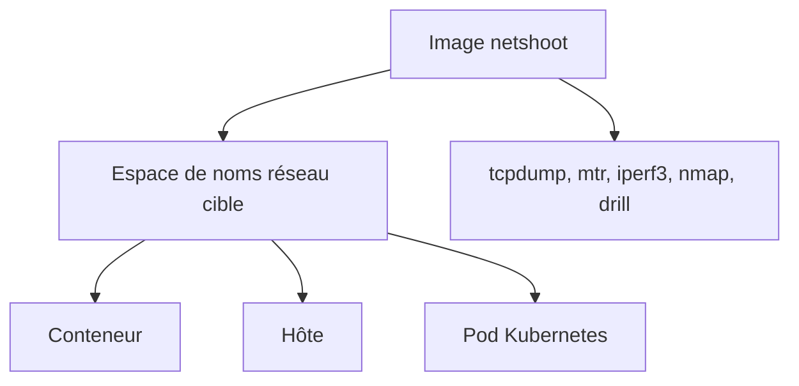

# nicolaka/netshoot

> Catch-all container of network tools for debugging Docker and Kubernetes, for infrastructure engineers.

## The problem
Diagnosing a network problem in a container without installing tools in it, which are often missing from the image.

## What it actually does
An image that enters the network namespace of a container, the host or a pod, with tcpdump, tshark, mtr, iperf3, nmap, drill, grpcurl, fortio, ctop, strace and others. Two multi-architecture images (amd64, arm64): Alpine by default and Debian.

## How it is wired


## Trying it
```bash
docker run -it --net container:<container_name> nicolaka/netshoot
docker run -it --net host nicolaka/netshoot
kubectl debug <pod> -it --image=nicolaka/netshoot
kubectl run tmp-shell --rm -i --tty --image nicolaka/netshoot
```

## Cost and gotchas
Free. Host mode and `--privileged` mode grant broad permissions. The README advises pinning a digest rather than a floating tag.

## What it is not
Not a tool to leave running in production: it is a disposable debugging session image.

## Alternatives
- kubectl-netshoot: a plugin that wraps the commands above.

## For you
Adopt: useful as soon as you deploy models on Kubernetes and the network or DNS causes trouble; pin a digest.
