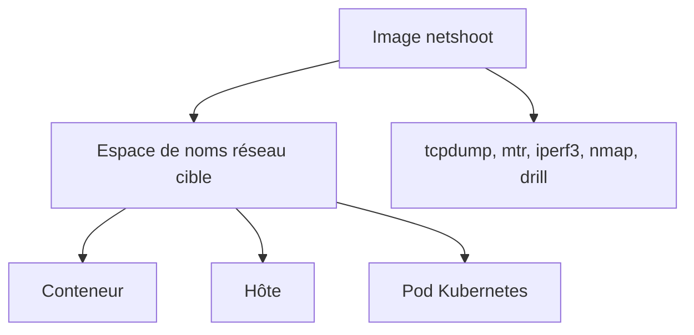

# nicolaka/netshoot

> Conteneur fourre-tout d'outils réseau pour déboguer Docker et Kubernetes, pour ingénieurs d'infrastructure.

## Le problème
Diagnostiquer un problème réseau dans un conteneur sans y installer d'outils, souvent absents de l'image.

## Ce que ça fait vraiment
Image qui entre dans l'espace de noms réseau d'un conteneur, de l'hôte ou d'un pod, avec tcpdump, tshark, mtr, iperf3, nmap, drill, grpcurl, fortio, ctop, strace et d'autres. Deux images multi-architecture (amd64, arm64) : Alpine par défaut et Debian.

## Comment c'est branché


## Essayer
```bash
docker run -it --net container:<container_name> nicolaka/netshoot
docker run -it --net host nicolaka/netshoot
kubectl debug <pod> -it --image=nicolaka/netshoot
kubectl run tmp-shell --rm -i --tty --image nicolaka/netshoot
```

## Coût et pièges
Gratuit. Le mode hôte et le mode `--privileged` donnent de larges droits. Le README conseille de fixer un digest plutôt qu'une étiquette flottante.

## Ce que ce n'est pas
Pas un outil à laisser tourner en production : c'est une image de session de débogage jetable.

## Alternatives
- kubectl-netshoot : plugin qui enveloppe les commandes ci-dessus.

## Pour toi
Adopter : utile dès que tu déploies des modèles sur Kubernetes et que le réseau ou le DNS pose problème ; épingler un digest.

