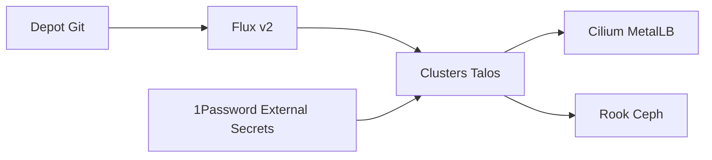

# nicolerenee/infra

> GitOps repository of a Kubernetes homelab on Talos Linux with Flux, managed by a single person.

## The problem
Maintaining two reproducible home clusters, without configuring the nodes or applications by hand.

## What it actually does
Two clusters, atlantis-k8s01 (5 nodes, colocation) and fairy-k8s01 (3 nodes, home). Flux v2 applies the changes, Cilium and MetalLB handle networking, Rook Ceph storage, External Secrets with 1Password the secrets. Applications: media, home automation, VictoriaMetrics and Grafana monitoring.

## How it is wired
Simplified diagram based on the sheet, no diagram provided.



## Trying it
```bash
task talos:generate CLUSTER=atlantis-k8s01
task talos:apply-config CLUSTER=atlantis-k8s01 node=atlantis-compute01
task talos:talosconfig CLUSTER=atlantis-k8s01
```

## Cost and gotchas
Dedicated hardware, Talos, Flux CLI, Task and a 1Password account. MetalLB requires BGP configuration, Rook Ceph dedicated disks. No license: the code cannot be legally reused.

## What it is not
Not a reusable template: it is the personal configuration of specific nodes. The README says nothing about the data or AI use case.

## Alternatives
No alternative named in the README.

## For you
Ignore: homelab configuration with no license and unrelated to AI, useful only as a read of a Flux-with-Talos setup.
