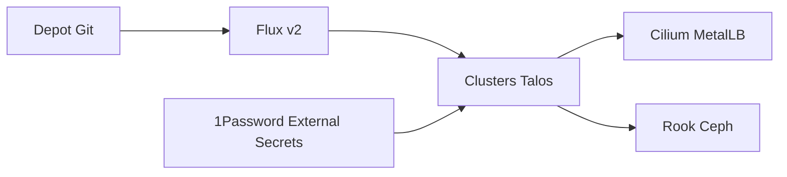

# nicolerenee/infra

> Dépôt GitOps d'un homelab Kubernetes sur Talos Linux avec Flux, géré par une seule personne.

## Le problème
Maintenir deux clusters maison reproductibles, sans reconfigurer les nœuds ni les applications à la main.

## Ce que ça fait vraiment
Deux clusters, atlantis-k8s01 (5 nœuds, colocation) et fairy-k8s01 (3 nœuds, maison). Flux v2 applique les changements, Cilium et MetalLB gèrent le réseau, Rook Ceph le stockage, External Secrets avec 1Password les secrets. Applications : médias, domotique, supervision VictoriaMetrics et Grafana.

## Comment c'est branché
Schéma simplifié d'après la fiche, sans diagramme fourni.



## Essayer
```bash
task talos:generate CLUSTER=atlantis-k8s01
task talos:apply-config CLUSTER=atlantis-k8s01 node=atlantis-compute01
task talos:talosconfig CLUSTER=atlantis-k8s01
```

## Coût et pièges
Matériel dédié, Talos, Flux CLI, Task et un compte 1Password. MetalLB demande une configuration BGP, Rook Ceph des disques dédiés. Aucune licence : le code n'est pas réutilisable légalement.

## Ce que ce n'est pas
Pas un modèle réutilisable : c'est la configuration personnelle de nœuds précis. Le README ne dit rien sur le cas d'usage data ou IA.

## Alternatives
Aucune alternative nommée dans le README.

## Pour toi
Ignorer : configuration de homelab sans licence et sans rapport avec l'IA, utile seulement comme lecture d'un montage Flux avec Talos.

