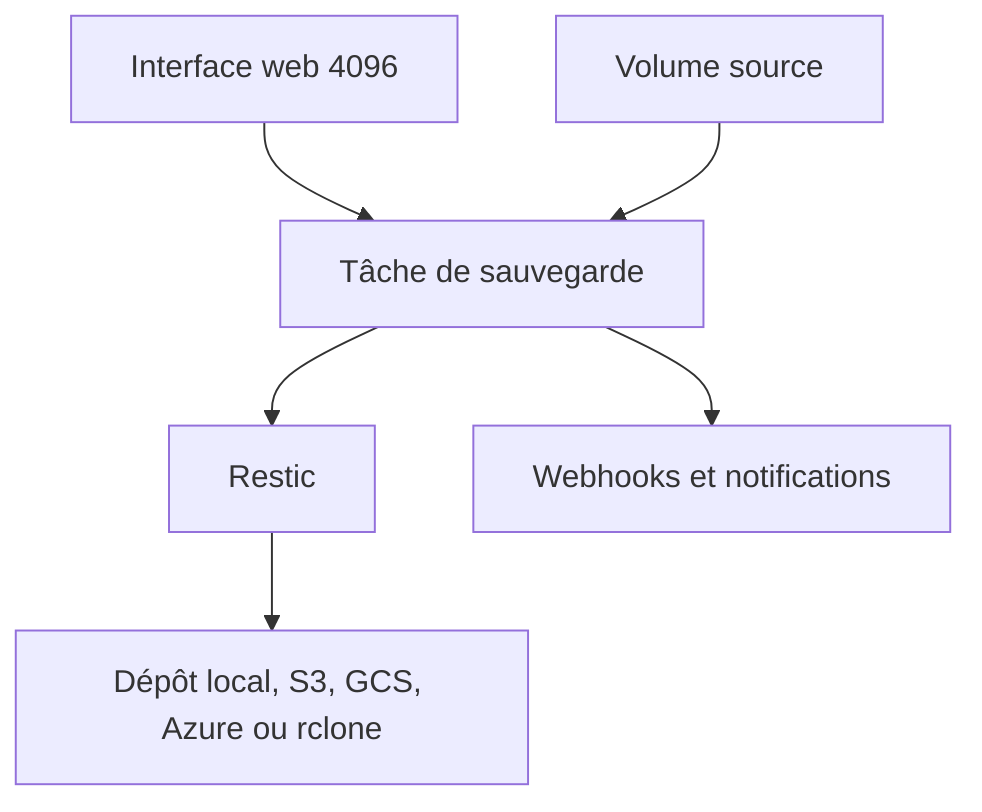

# nicotsx/zerobyte

> Web interface to schedule and monitor encrypted backups, built on Restic.

## The problem
Restic alone is command-line: scheduling, retention and monitoring are left to script.

## What it actually does
A container with a web interface: source volumes (directories, NFS, SMB, WebDAV, SFTP), target repositories (local, S3, Google Cloud Storage, Azure, rclone), scheduled jobs with retention policies, restore by snapshot, webhooks and notifications. Authentication via better-auth.

## How it is wired

Diagram not provided: simplified diagram based on the README.

## Trying it
```bash
openssl rand -hex 32
docker compose up -d
# Interface : http://<hôte>:4096 (compose.yaml fourni dans le README, image ghcr.io/nicotsx/zerobyte:v0.44)
```

## Cost and gotchas
Docker with `SYS_ADMIN` and `/dev/fuse` for remote mounts (removable if unneeded). `BASE_URL` and `APP_SECRET` are mandatory. Direct Internet exposure is not recommended.

## What it is not
No fine-grained permissions: every member of an organization operates on the backups. Do not put `/var/lib/zerobyte` on a network share.

## Alternatives
- Restic (named in the README): the underlying tool, on the command line.
- rclone: for synchronization to many clouds.

## For you
Worth watching: handy for backing up datasets or models in self-hosted mode, a young project run by one person.
