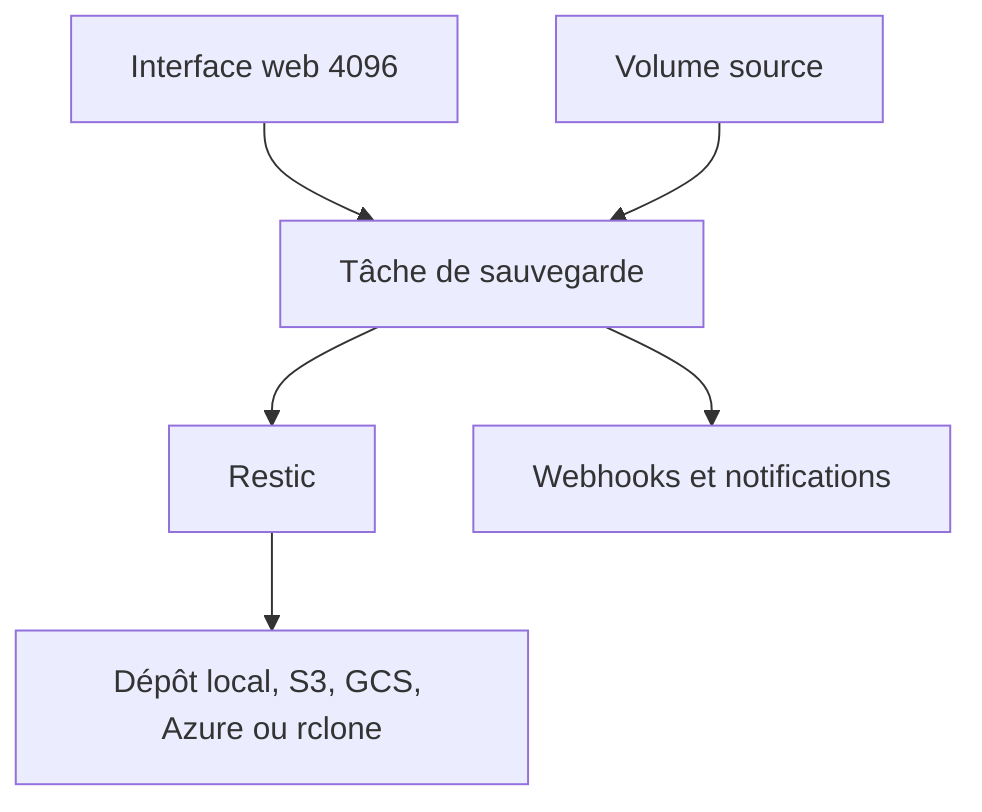

# nicotsx/zerobyte

> Interface web pour planifier et surveiller des sauvegardes chiffrées, bâtie sur Restic.

## Le problème
Restic seul est en ligne de commande : planification, rétention et supervision restent à scripter.

## Ce que ça fait vraiment
Un conteneur avec interface web : volumes sources (répertoires, NFS, SMB, WebDAV, SFTP), dépôts cibles (local, S3, Google Cloud Storage, Azure, rclone), tâches planifiées avec politiques de rétention, restauration par instantané, webhooks et notifications. Authentification via better-auth.

## Comment c'est branché

Schéma non fourni : diagramme simplifié d'après le README.

## Essayer
```bash
openssl rand -hex 32
docker compose up -d
# Interface : http://<hôte>:4096 (compose.yaml fourni dans le README, image ghcr.io/nicotsx/zerobyte:v0.44)
```

## Coût et pièges
Docker avec `SYS_ADMIN` et `/dev/fuse` pour les montages distants (retirables si inutiles). `BASE_URL` et `APP_SECRET` obligatoires. Pas d'exposition Internet directe conseillée.

## Ce que ce n'est pas
Pas de gestion fine des droits : tout membre d'une organisation opère sur les sauvegardes. Ne pas placer `/var/lib/zerobyte` sur un partage réseau.

## Alternatives
- Restic (nommé dans le README) : l'outil sous-jacent, en ligne de commande.
- rclone : pour la synchronisation vers de nombreux clouds.

## Pour toi
À surveiller : pratique pour sauvegarder des jeux de données ou modèles en autohébergé, projet jeune porté par une personne.

