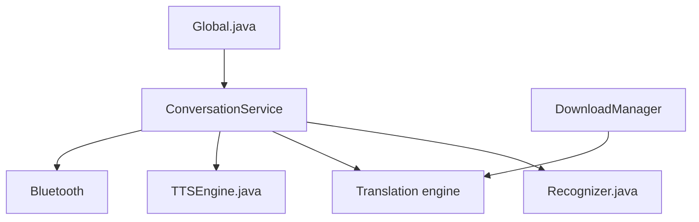

# niedev/RTranslator

> Android app for real-time, offline voice translation, with embedded models.

## The problem
Talking with someone who doesn't share your language, with no connection, no account, and no data sent to a server.

## What it actually does
Three modes: conversation (two phones over Bluetooth), walkie-talkie (a single phone, turn-taking) and text translation. Whisper handles speech recognition; translation goes through NLLB, or in v3 Bergamot, Madlad 400 3B or HY-MT 1.5 1.8B, via OnnxRuntime. Speech synthesis uses the system's own.

## How it is wired

## Trying it
No command: install the apk from the releases page; on first launch the app downloads the models (1.2 GB).

## Cost and gotchas
Free, no ads. At least 6 GB of RAM is required; 1.2 GB of models to download. The app is still in beta (the Bluetooth connection sometimes drops).

## What it is not
Not true simultaneous translation in walkie-talkie mode. No iOS version. v1 relied on paid Google APIs.

## Alternatives
No alternative named in the README.

## For you
Worth watching: a useful example of quantized Whisper and NLLB models in ONNX on mobile, but it is a consumer product, and in beta.
