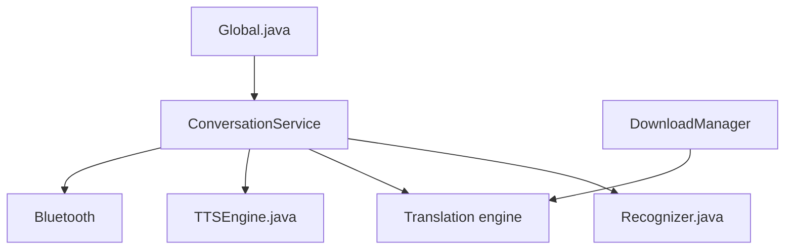

# niedev/RTranslator

> Application Android de traduction vocale en temps réel, hors ligne, avec modèles embarqués.

## Le problème
Parler avec quelqu'un qui n'a pas ta langue sans connexion ni compte, ni envoi de données à un serveur.

## Ce que ça fait vraiment
Trois modes : conversation (deux téléphones en Bluetooth), talkie-walkie (un seul téléphone, tour de parole) et traduction de texte. Whisper fait la reconnaissance vocale ; la traduction passe par NLLB, ou dans la v3 Bergamot, Madlad 400 3B ou HY-MT 1.5 1.8B, via OnnxRuntime. La synthèse vocale utilise celle du système.

## Comment c'est branché

## Essayer
Aucune commande : installer l'apk depuis la page des releases ; au premier lancement l'app télécharge les modèles (1,2 Go).

## Coût et pièges
Gratuit, sans publicité. Il faut au moins 6 Go de RAM ; 1,2 Go de modèles à télécharger. L'app est encore en bêta (connexion Bluetooth qui saute parfois).

## Ce que ce n'est pas
Pas de la vraie traduction simultanée en mode talkie-walkie. Pas de version iOS. La v1 passait par des API Google payantes.

## Alternatives
Aucune alternative nommée dans le README.

## Pour toi
À surveiller : exemple utile de modèles Whisper et NLLB quantifiés en ONNX sur mobile, mais c'est un produit grand public, et en bêta.

