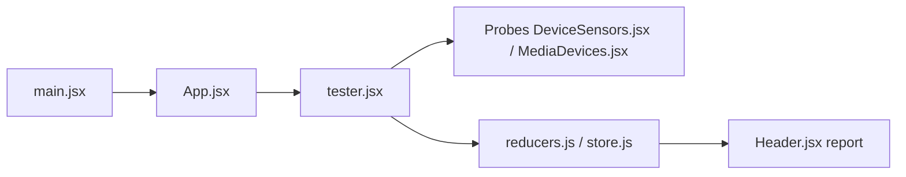

# niespodd/browser-fingerprinting

> Watch guide on anti-bot protections and fingerprinting, with a small browser fingerprint tester.

## The problem
A legitimate scraper runs into anti-bot protections whose mechanisms (fingerprints, TLS, behavior) are poorly documented.

## What it actually does
- The README is mostly a guide: use cases, proxy and scraping providers, a list of anti-bot vendors, stealth browsers, fingerprint test pages.
- It records observations on evasion plugins (puppeteer-extra-plugin-stealth) and alternative projects (nodriver, patchright, camoufox).
- It also contains an opinionated take: according to the author, anti-bots only make scraping more expensive.
- The code is a React/Redux tester: probes (sensors, media, extensions…) produce a hashable, shareable report.

## How it is wired

## Trying it
No command documented in the README: the content is documentation to read.

## Cost and gotchas
Free, but the guide steers toward paid services (proxies, scraping, captcha solving); it itself warns that some stealth browsers may contain malware. No license declared.

## What it is not
Not a ready-to-use tool. Bypassing anti-bot protections may violate a site's terms or the law: check authorization and terms of service before any scraping.

## Alternatives
To bypass detection: nodriver, rebrowser-patches, patchright, camoufox (cited in the README); to test your fingerprint: EFF Cover Your Tracks, browserleaks.

## For you
Ignore: mostly an anti-bot evasion guide with no license; useful only as watch material if you need to understand bot detection.
