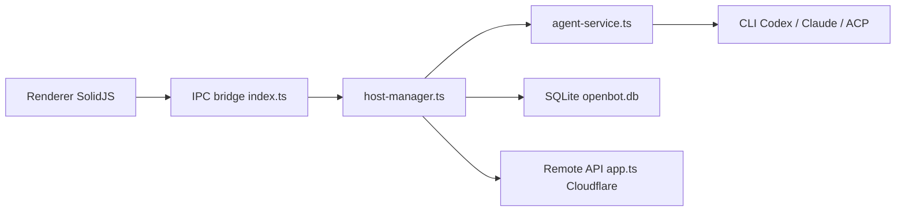

# nightly-labs/openbot

> A desktop workspace for persistent AI agents (Codex, Claude Code, Grok, Gemini…), each with its own folder.

## The problem
Driving several separate CLI agents, with their queues, files and browser, takes a lot of manual handling.

## What it actually does
Electron application: one agent per workspace, FIFO message queues, exchanges between agents, shared channels, built-in browser controlled by the agents, optional Computer Use, local skills, marketplace. Codex and Claude sessions go through their local CLIs, other providers through ACP. Remote server (VPS, Docker, Nix) and mobile application.

## How it is wired


## Trying it
```bash
curl -fsSL https://raw.githubusercontent.com/nightly-labs/openbot/main/scripts/install-server.sh | sudo bash
sudo openbot login
bun install --frozen-lockfile
bun run dev
```

## Cost and gotchas
Each provider's subscription or key is at your expense. OpenBot account is optional (email codes, API on Cloudflare). Agents run with `danger-full-access` and `approvalPolicy: never`: no confirmation per action.

## What it is not
Not free software: the README says so and the license is not recognized by GitHub. Not offline: local first, but each agent calls its provider. A development preview, not a stabilized product.

## Alternatives
No alternative named in the README.

## For you
Ignore: full system access without confirmation, a non-free license and preview status are too great risks for a machine that handles data.
