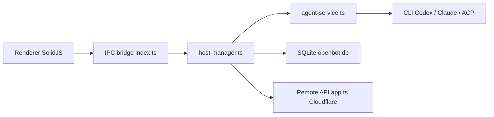

# nightly-labs/openbot

> Un espace de travail de bureau pour des agents IA persistants (Codex, Claude Code, Grok, Gemini…), chacun avec son dossier.

## Le problème
Piloter plusieurs agents CLI séparés, avec leurs files, fichiers et navigateur, demande beaucoup de manipulations.

## Ce que ça fait vraiment
Application Electron : un agent par espace, files de messages FIFO, échanges entre agents, canaux partagés, navigateur intégré contrôlé par les agents, Computer Use optionnel, skills locaux, marketplace. Sessions Codex et Claude via leurs CLI locaux, autres fournisseurs via ACP. Serveur distant (VPS, Docker, Nix) et application mobile.

## Comment c'est branché


## Essayer
```bash
curl -fsSL https://raw.githubusercontent.com/nightly-labs/openbot/main/scripts/install-server.sh | sudo bash
sudo openbot login
bun install --frozen-lockfile
bun run dev
```

## Coût et pièges
Abonnement ou clé de chaque fournisseur à ta charge. Compte OpenBot optionnel (codes par e-mail, API sur Cloudflare). Les agents tournent en `danger-full-access` et `approvalPolicy: never` : aucune confirmation par action.

## Ce que ce n'est pas
Pas un logiciel libre : le README le dit et la licence n'est pas reconnue par GitHub. Pas hors-ligne : local d'abord, mais chaque agent appelle son fournisseur. Aperçu de développement, pas un produit stabilisé.

## Alternatives
Aucune alternative nommée dans le README.

## Pour toi
Ignorer : accès complet au système sans confirmation, licence non libre et statut de préversion sont des risques trop forts pour un poste qui touche des données.

