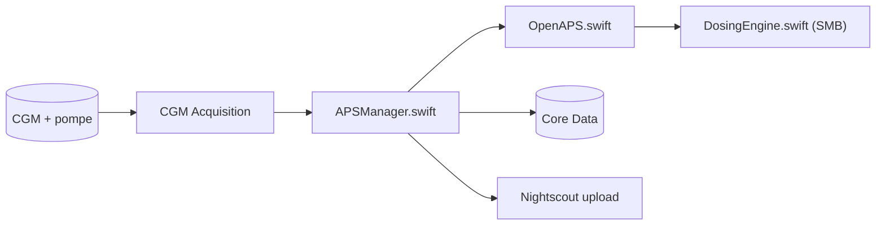

# nightscout/Trio

> Open automated insulin delivery system for iOS, based on the OpenAPS algorithm.

## The problem
People with diabetes want a configurable system that adjusts insulin from the glucose sensor and the pump.

## What it actually does
From the code: glucose acquisition (Bluetooth, plugins), storage of carbs and events in Core Data, OpenAPS computation (autosensitivity, predictions, basal determination, SMB rule), SwiftUI interface, Watch app, Live Activity and Nightscout synchronisation. The exact link between the loop coordinator and the pump cannot be verified in the sample.

## How it is wired


## Trying it
```bash
git clone --branch=<branch> --recurse-submodules https://github.com/nightscout/Trio.git && cd Trio
echo 'DEVELOPER_TEAM = xxxxxxxxxx' > ConfigOverride.xcconfig
xed .
```

## Cost and gotchas
Requires an Apple developer ID and Xcode (or a build via GitHub/TestFlight). The README warns: use at your own risk, not CE or FDA approved.

## What it is not
Not an approved medical device. Automated insulin dosing is not a playground for a data profile.

## Alternatives
The README cites Loop (LoopKit), FreeAPS X and iAPS as the project's origins.

## For you
Ignore: uncertified insulin-dosing software, outside your scope; reading it only makes sense as an algorithm study.
