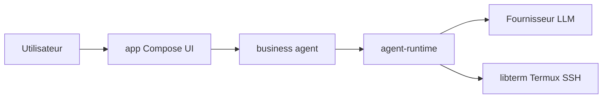

# niki914/zafiro

> Open-source AI agent for Android that reads the screen and controls the phone, with your own model keys.

## The problem
A phone's voice assistants don't perform complex operations across apps, and don't let you choose your model.

## What it actually does
A Kotlin app drives the phone through the accessibility service, or through Shizuku without root for non-native apps. It supports skills, MCP, memory, Shell and Python 3 execution (Chaquopy), SSH, Termux and remote Claude Code. A safety guard asks for confirmation on sensitive actions. With root and LSPosed, it can replace the system voice assistant (OPPO Breeno only).

## How it is wired


## Trying it
```bash
./gradlew assembleDebug

./gradlew assembleRelease \
  -PRELEASE_STORE_FILE=/absolute/path/to/my-release.jks \
  -PRELEASE_STORE_PASSWORD=yourStorePassword \
  -PRELEASE_KEY_ALIAS=my_key \
  -PRELEASE_KEY_PASSWORD=yourKeyPassword
```

## Cost and gotchas
Android 11 minimum; build with Android Studio or the Android SDK and a JDK 17 (Java is not in the list of prerequisites). Model keys are at your expense. Taking over the voice assistant requires root and LSPosed.

## What it is not
Not a model or a service: no AI is included. Not for iOS or desktop. Voice takeover only works on certain phones.

## Alternatives
No alternative named in the README.

## For you
Ignore: an Android phone-control agent for personal use, outside your data, AI or MLOps scope, and carried by a single author.
