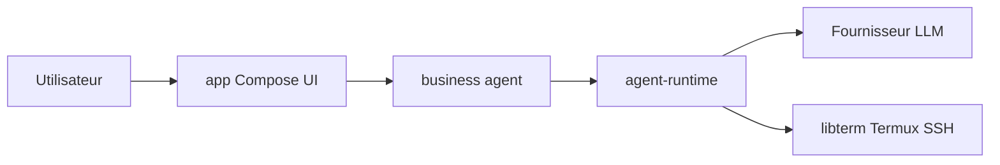

# niki914/zafiro

> Agent IA open source pour Android qui lit l'écran et commande le téléphone, avec ses propres clés de modèles.

## Le problème
Les assistants vocaux d'un téléphone ne font pas des opérations complexes entre applications, et ne laissent pas choisir son modèle.

## Ce que ça fait vraiment
Une application Kotlin pilote le téléphone par service d'accessibilité, ou par Shizuku sans root pour les applications non natives. Elle prend en charge skills, MCP, mémoire, exécution de Shell et de Python 3 (Chaquopy), SSH, Termux et Claude Code distant. Une garde de sécurité demande confirmation pour les actions sensibles. Avec root et LSPosed, elle peut remplacer l'assistant vocal du système (OPPO Breeno seulement).

## Comment c'est branché


## Essayer
```bash
./gradlew assembleDebug

./gradlew assembleRelease \
  -PRELEASE_STORE_FILE=/absolute/path/to/my-release.jks \
  -PRELEASE_STORE_PASSWORD=yourStorePassword \
  -PRELEASE_KEY_ALIAS=my_key \
  -PRELEASE_KEY_PASSWORD=yourKeyPassword
```

## Coût et pièges
Android 11 minimum ; compilation avec Android Studio ou le SDK Android et un JDK 17 (Java n'existe pas dans la liste des prérequis). Les clés de modèles sont à ta charge. La prise de contrôle de l'assistant vocal exige root et LSPosed.

## Ce que ce n'est pas
Pas un modèle ni un service : aucune IA n'est incluse. Pas pour iOS ni pour ordinateur. La prise de contrôle vocale ne fonctionne que sur certains téléphones.

## Alternatives
Aucune alternative nommée dans le README.

## Pour toi
À ignorer : agent de pilotage de téléphone Android pour un usage personnel, hors de ton périmètre data, IA ou MLOps, et porté par un seul auteur.

