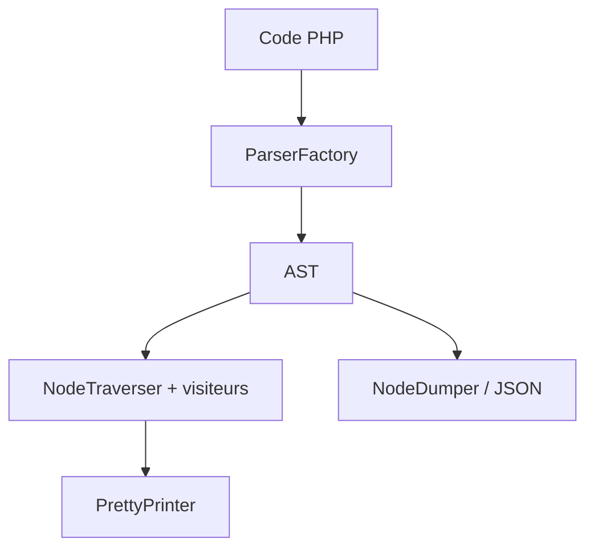

# nikic/PHP-Parser

> PHP parser written in PHP that produces a syntax tree for code analysis and transformation.

## The problem
Analyzing or transforming PHP code with regex is fragile; a reliable syntax tree is needed.

## What it actually does
Turns PHP 7 and 8 code into an AST with positions, including a partial AST for invalid code. Lets you traverse and modify the tree (visitors), rewrite it as PHP while preserving formatting, resolve names, evaluate constants and export to JSON.

## How it is wired
Simplified diagram based on the fiche, no diagram provided.



## Trying it
```bash
php composer.phar require nikic/php-parser
```

## Cost and gotchas
Free. Requires PHP >= 7.4 for version 5.x and Composer, both missing from the prerequisites list.

## What it is not
Not a ready-to-use analysis tool: a building block for making one. Covers PHP 5.x only in a limited way.

## Alternatives
None named in the README.

## For you
Ignore: only useful if you build tooling for PHP code, unrelated to a data / AI / MLOps profile.
