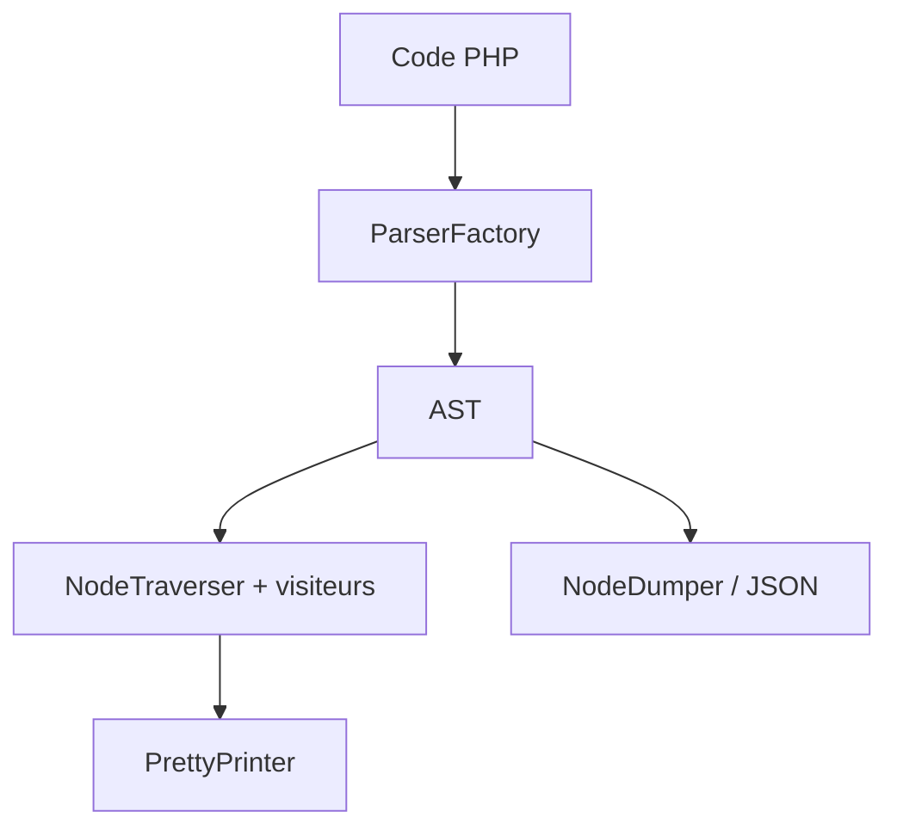

# nikic/PHP-Parser

> Analyseur PHP écrit en PHP qui produit un arbre syntaxique pour l'analyse et la transformation de code.

## Le problème
Analyser ou transformer du code PHP par regex est fragile ; il faut un arbre syntaxique fiable.

## Ce que ça fait vraiment
Transforme du code PHP 7 et 8 en AST avec positions, y compris un AST partiel pour du code invalide. Permet de parcourir et modifier l'arbre (visiteurs), de le réécrire en PHP en préservant le formatage, de résoudre les noms, d'évaluer des constantes et d'exporter en JSON.

## Comment c'est branché
Schéma simplifié d'après la fiche, sans diagramme fourni.



## Essayer
```bash
php composer.phar require nikic/php-parser
```

## Coût et pièges
Gratuit. Nécessite PHP >= 7.4 pour la version 5.x et Composer, absents de la liste des prérequis.

## Ce que ce n'est pas
Pas un outil d'analyse prêt à l'emploi : une brique pour en construire. Ne couvre PHP 5.x que de façon limitée.

## Alternatives
Aucune nommée dans le README.

## Pour toi
À ignorer : utile seulement si tu outilles du code PHP, sans lien avec un profil data / IA / MLOps.

