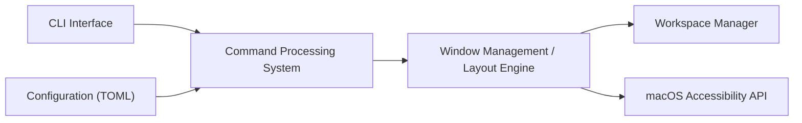

# nikitabobko/AeroSpace

> Tiling window manager for macOS, inspired by i3, for advanced users.

## The problem
macOS offers no keyboard-driven tiling layout, and its native Spaces are limited.

## What it actually does
Organizes windows in a tree (i3 paradigm), emulates its own workspaces instead of macOS Spaces, handles multiple monitors, is configured through a TOML file and is driven from the command line. It does not require disabling SIP. The project is in public beta with breaking changes expected before version 1.0. It is not notarized.

## How it is wired


## Trying it
```bash
brew install --cask nikitabobko/tap/aerospace
```

## Cost and gotchas
Free. macOS 13+ only. Not notarized: the Homebrew script removes the quarantine attribute. Known instabilities (windows jumping between spaces).

## What it is not
It is not compatible with native macOS Spaces. The author rules out a graphical configuration interface and aesthetics.

## Alternatives
- yabai: macOS window manager with binary space partitioning.
- Amethyst: xmonad-style manager.

## For you
Ignore: personal macOS desktop comfort, beta, unrelated to data/AI/MLOps needs.
