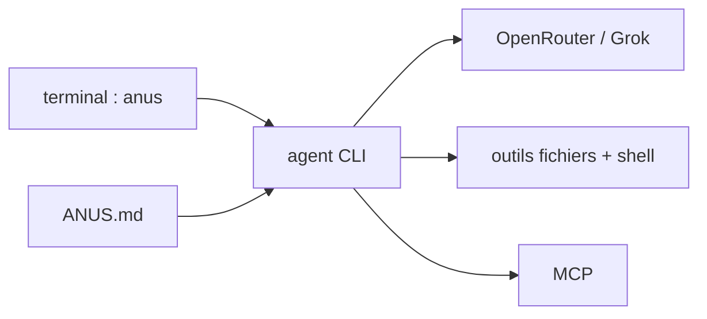

# nikmcfly/ANUS

> Grok terminal agent in Node, bootstrapped by an AI, for people testing generated agents.

## The problem
CLI coding agents are closed or tied to a vendor; this project tests the idea of an agent that takes part in its own development.

## What it actually does
Node 20+ CLI optimized for `xai/grok-code-fast-1` via OpenRouter. It offers workspace tools (files, sandboxed shell commands), extension through MCP and an `ANUS.md` project-context file. The README says the code is 99% AI-generated and requires 80% AI code in contributions.

## How it is wired


## Trying it
```bash
npm install -g @anus-dev/anus
anus
```

## Cost and gotchas
OpenRouter key at your own expense, entered on first launch. The "sandboxed" shell is not detailed.

## What it is not
Not a proven agent: it is an experiment, governance and quality are undocumented, and the 80% AI rule is surprising.

## Alternatives
No alternative named in the README.

## For you
Ignore: poorly documented experiment, while more established CLI agents exist.
