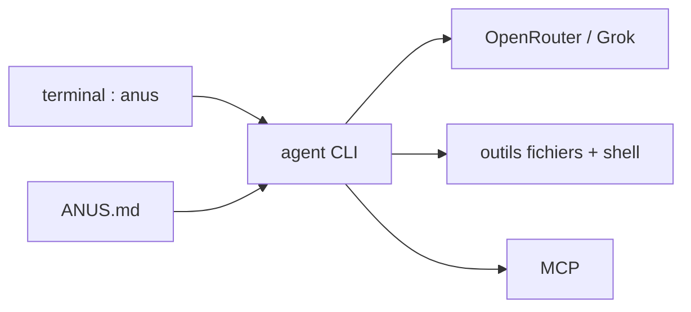

# nikmcfly/ANUS

> Agent de terminal Grok en Node, amorcé par une IA, pour qui teste des agents générés.

## Le problème
Les agents de code en CLI sont fermés ou liés à un fournisseur ; ce projet teste l'idée d'un agent qui participe à son propre développement.

## Ce que ça fait vraiment
CLI Node 20+ optimisée pour `xai/grok-code-fast-1` via OpenRouter. Elle propose des outils d'espace de travail (fichiers, commandes shell en bac à sable), l'extension par MCP et un fichier `ANUS.md` de contexte projet. Le README dit le code à 99 % généré par IA et exige 80 % de code IA dans les contributions.

## Comment c'est branché


## Essayer
```bash
npm install -g @anus-dev/anus
anus
```

## Coût et pièges
Clé OpenRouter à ta charge, saisie au premier lancement. Le shell « en bac à sable » n'est pas détaillé.

## Ce que ce n'est pas
Pas un agent éprouvé : c'est une expérience, la gouvernance et la qualité sont non documentées, et la règle des 80 % IA surprend.

## Alternatives
Aucune alternative nommée dans le README.

## Pour toi
À ignorer : expérience peu documentée, alors que des agents CLI plus établis existent.

