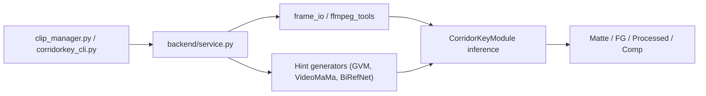

# nikopueringer/CorridorKey

> Green screen keying model that restores foreground color and linear alpha, for VFX artists.

## The problem
On a green background, edges (hair, motion blur) mix subject and background; classic keyers and AI rotoscoping give hard masks and lose semi-transparency.

## What it actually does
From a raw image and a coarse mask ("AlphaHint"), the network predicts for each pixel the straight foreground color and a linear alpha. The mask can come from GVM, VideoMaMa or BiRefNet, integrated as options. EXR outputs (`Matte`, `FG`, `Processed`) and a PNG preview. Green or blue screen detected automatically; Torch backends (CUDA, ROCm, MPS, CPU) and MLX.

## How it is wired


## Trying it
```bash
uv sync
uv sync --extra cuda
docker build -t corridorkey:latest .
docker compose --profile gpu run --rm corridorkey run_inference --device cuda
uv run python clip_manager.py --action run_inference --device cpu
```

## Cost and gotchas
Designed on a card with 96 GB of VRAM; 6 to 8 GB advertised for the recent version, about 18 GB on AMD at 2048×2048. GVM requires about 80 GB of VRAM. License close to CC BY-NC-SA: commercial reuse of the software is allowed, but no resale, no paid inference API, and variants keep the name and license.

## What it is not
It is not a turnkey tool without an input mask: quality depends on the supplied mask. No training code or datasets published to date.

## Alternatives
The README cites GVM, VideoMaMa and BiRefNet, but as integrated mask generators rather than as competitors.

## For you
Keep an eye on it: an interesting matting model to test on GPU, but with a particular license, VFX-oriented EXR output and a young project run by one person.
