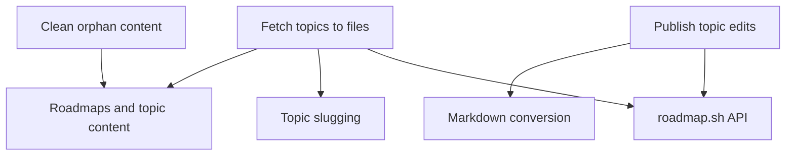

# nilbuild/developer-roadmap

> Same content as roadmap.sh: roadmaps texts, synchronized with the API and the website database.

## The problem
Keep the descriptions and resources for the roadmaps up-to-date, both in the Markdown repository and on the website.

## What it actually does
The README is identical to that of kamranahmedse/developer-roadmap (same stars next to each other, same dates). The sample code demonstrates scripts that retrieve topics from the API and save them to files, publish changes to the database, and clean up orphaned files. The code for the public application is not included.

## How it is wired


## Trying it
```bash
git clone git@github.com:nilbuild/developer-roadmap.git --depth 1
cd developer-roadmap
```

## Cost and gotchas
Free. License is present but not identified by GitHub. There appears to be a duplicate of the kamranahmedse repository: only one of the two should be followed.

## What it is not
This is not a tool that can be used externally: the synchronization scripts target the website's API, not your own project roadmaps.

## Alternatives
No alternative is specified in the README.

## For you
Please ignore: this is a duplicate of the KamranAhmedse account, which has no independent value for your profile; please consult roadmap.sh directly.
