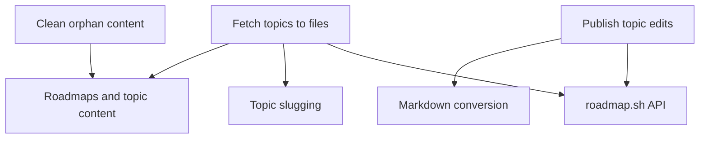

# nilbuild/developer-roadmap

> Même contenu que roadmap.sh : textes des roadmaps, synchronisés avec l'API et la base du site.

## Le problème
Garder à jour les descriptions et ressources des roadmaps entre un dépôt Markdown et le site.

## Ce que ça fait vraiment
README identique à celui de kamranahmedse/developer-roadmap (mêmes étoiles à deux près, mêmes dates). Le code échantillonné montre des scripts qui récupèrent les sujets depuis l'API vers des fichiers, publient les modifications vers la base, et nettoient les fichiers orphelins. Le code de l'application publique n'y figure pas.

## Comment c'est branché


## Essayer
```bash
git clone git@github.com:nilbuild/developer-roadmap.git --depth 1
cd developer-roadmap
```

## Coût et pièges
Gratuit. Licence présente mais non identifiée par GitHub. Doublon apparent du dépôt kamranahmedse : un seul des deux est à suivre.

## Ce que ce n'est pas
Ce n'est pas un outil utilisable de l'extérieur : les scripts de synchronisation visent l'API du site, pas vos propres roadmaps.

## Alternatives
Aucune alternative nommée dans le README.

## Pour toi
À ignorer : c'est le doublon du dépôt kamranahmedse, sans valeur propre pour ton profil ; consulte roadmap.sh directement.

