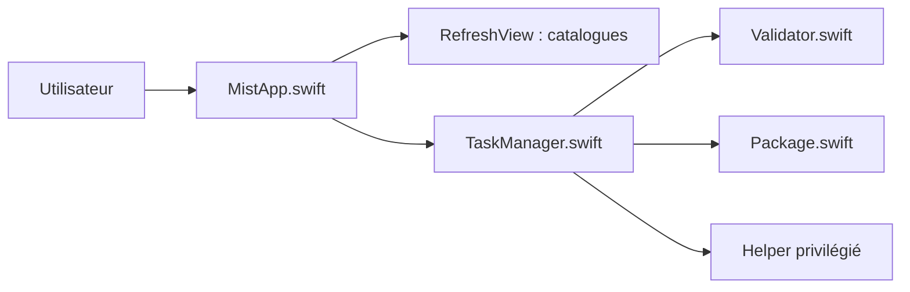

# ninxsoft/Mist

> macOS app that downloads macOS firmwares and installers and builds images, packages and ISOs.

## The problem
Cleanly retrieving an old or beta macOS installer, or an Apple Silicon firmware, is tedious.

## What it actually does
Lists available versions (name, build, size, date) and exports to CSV, JSON, plist or YAML. Downloads `.ipsw` firmwares (SHA-1 verified) or generates `.app`, `.dmg`, bootable `.iso` and `.pkg` for Intel. Chooses a Standard or Seed catalogue, validates checksums, retries failed downloads. A privileged helper runs the sensitive operations.

## How it is wired


## Trying it
```bash
brew install --cask mist
```

## Cost and gotchas
Free. macOS Monterey 12 or later. Full disk access is sometimes needed. Seed catalogues may contain betas and require membership in Apple programs.

## What it is not
Not cross-platform nor a virtualization tool: it prepares images for Parallels, UTM, VMware or VirtualBox. The command-line tool is a separate project (mist-cli).

## Alternatives
- mist-cli: same function on the command line, cited in the README.

## For you
Ignore: a macOS administration utility with no link to data/AI, unless you need a macOS VM.
