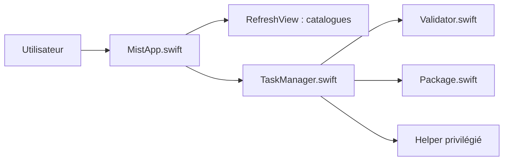

# ninxsoft/Mist

> App macOS qui télécharge firmwares et installeurs macOS et fabrique images, paquets et ISO.

## Le problème
Récupérer proprement un installeur macOS ancien ou bêta, ou un firmware Apple Silicon, est fastidieux.

## Ce que ça fait vraiment
Liste les versions disponibles (nom, build, taille, date) et exporte en CSV, JSON, plist ou YAML. Télécharge les firmwares `.ipsw` (SHA-1 vérifié) ou génère `.app`, `.dmg`, `.iso` amorçable et `.pkg` pour Intel. Choisit un catalogue Standard ou Seed, valide les checksums, relance les téléchargements échoués. Un helper privilégié exécute les opérations sensibles.

## Comment c'est branché


## Essayer
```bash
brew install --cask mist
```

## Coût et pièges
Gratuit. macOS Monterey 12 ou plus. Accès disque complet parfois nécessaire. Les catalogues Seed peuvent contenir des bêtas et exigent l'appartenance aux programmes Apple.

## Ce que ce n'est pas
Pas multiplateforme ni un outil de virtualisation : il prépare les images pour Parallels, UTM, VMware ou VirtualBox. L'outil en ligne de commande est un projet à part (mist-cli).

## Alternatives
- mist-cli : même fonction en ligne de commande, cité dans le README.

## Pour toi
À ignorer : utilitaire macOS d'administration sans lien avec data/IA, sauf besoin de VM macOS.

