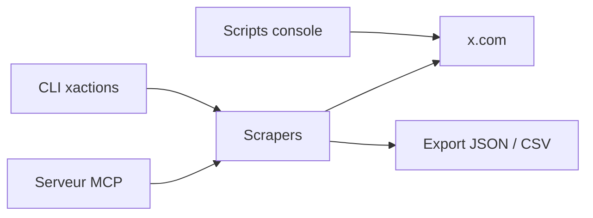

# nirholas/XActions

> X/Twitter automation toolkit: scrapers, CLI, console scripts, MCP server for agents.

## The problem
X's official API is paid, and automating an account by hand is tedious.

## What it actually does
Reads profiles, tweets and followers through the internal GraphQL API or a driven browser, with no API key. 56 CLI commands, scripts to paste into the console, a browser extension, an MCP server with daily caps and human validation of writes. Exports to JSON, CSV, Markdown, and migrates to Bluesky or Mastodon.

## How it is wired
Simplified diagram based on the sheet, no diagram provided.


## Trying it
```bash
npx xactions profile nasa
npx xactions tweets nasa --limit 100 --output nasa.csv
npx xactions login
```

## Cost and gotchas
Free locally. Bypassing the official API probably violates X's terms of use: risk of account blocking. The optional remote API charges per request.

## What it is not
It is not an official or stable API: X changes its request identifiers. The README speaks of educational use and is truncated.

## Alternatives
- twikit: Python scraper using cookies.
- twscrape: Python scraper with an account pool.
- xmcp: official MCP server, but with paid API keys.

## For you
Worth watching: useful for collecting X data for analysis, but fragile and risky with respect to X's terms.
