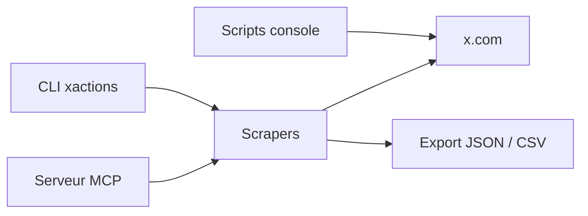

# nirholas/XActions

> Boîte à outils d'automatisation de X/Twitter : scrapers, CLI, scripts console, serveur MCP pour agents.

## Le problème
L'API officielle de X est payante, et automatiser un compte à la main est fastidieux.

## Ce que ça fait vraiment
Lit profils, tweets, abonnés par l'API GraphQL interne ou par navigateur piloté, sans clé d'API. 56 commandes CLI, scripts à coller dans la console, extension de navigateur, serveur MCP avec plafonds quotidiens et validation humaine des écritures. Exporte en JSON, CSV, Markdown, et migre vers Bluesky ou Mastodon.

## Comment c'est branché
Schéma simplifié d'après la fiche, sans diagramme fourni.


## Essayer
```bash
npx xactions profile nasa
npx xactions tweets nasa --limit 100 --output nasa.csv
npx xactions login
```

## Coût et pièges
Gratuit en local. Le contournement de l'API officielle contrevient sans doute aux conditions d'utilisation de X : risque de blocage de compte. L'API distante optionnelle facture par requête.

## Ce que ce n'est pas
Ce n'est pas une API officielle ni stable : X change ses identifiants de requête. Le README parle d'usage éducatif et reste tronqué.

## Alternatives
- twikit : scraper Python par cookies.
- twscrape : scraper Python avec pool de comptes.
- xmcp : serveur MCP officiel, mais avec clés d'API payantes.

## Pour toi
À surveiller : utile pour collecter des données X pour de l'analyse, mais fragile et risqué vis-à-vis des conditions de X.

