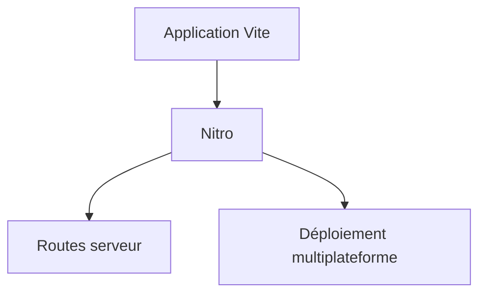

# nitrojs/nitro

> Vite extension that adds a server and routes, deployable on several platforms.

## The problem
A Vite application has no built-in production server for its routes and deployment.

## What it actually does
The very short README only says that Nitro adds a server to a Vite application, with server routes and zero-config multi-platform deployment. It indicates that the displayed branch is v3 and points to v2 for the stable version. The rest is not documented.

## How it is wired
Simplified diagram based on the sheet, no diagram provided.

## Trying it
No commands documented in the README; the documentation is at nitro.build.

## Cost and gotchas
Free. Node is required for Vite. The v3 branch is not the stable version. License present but not identified by GitHub.

## What it is not
Not a full framework: it extends Vite. The README says nothing more.

## Alternatives
No alternative named in the README.

## For you
Ignore: JavaScript web development tool, unrelated to data or MLOps, and too thin a source to judge.
