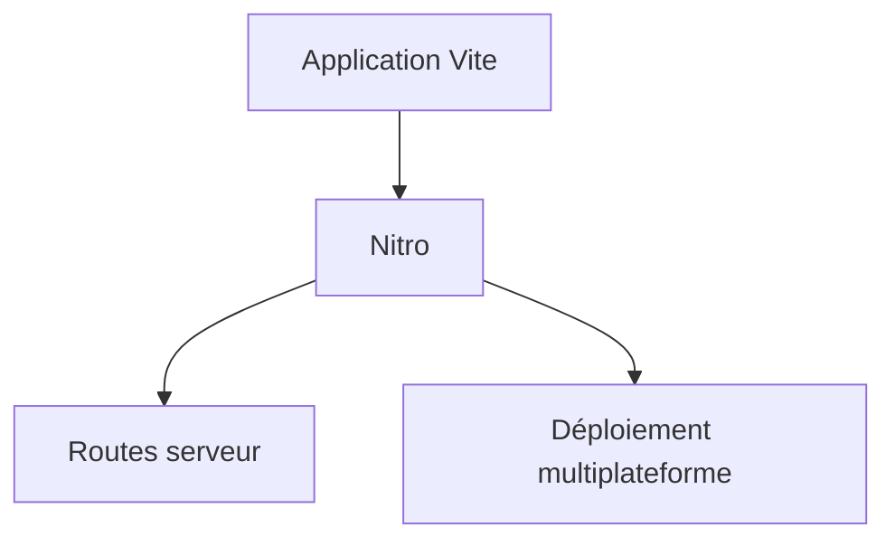

# nitrojs/nitro

> Extension de Vite qui ajoute un serveur et des routes, déployable sur plusieurs plateformes.

## Le problème
Une application Vite n'a pas de serveur de production intégré pour ses routes et son déploiement.

## Ce que ça fait vraiment
Le README, très court, dit seulement que Nitro ajoute un serveur à une application Vite, avec des routes serveur et un déploiement multiplateforme sans configuration. Il indique que la branche affichée est la v3 et renvoie à la v2 pour la version stable. Le reste n'est pas documenté.

## Comment c'est branché
Schéma simplifié d'après la fiche, sans diagramme fourni.

## Essayer
Aucune commande documentée dans le README ; la documentation est sur nitro.build.

## Coût et pièges
Gratuit. Node est nécessaire pour Vite. La branche v3 n'est pas la version stable. Licence présente mais non identifiée par GitHub.

## Ce que ce n'est pas
Pas un framework complet : il étend Vite. Le README ne dit rien de plus.

## Alternatives
Aucune alternative nommée dans le README.

## Pour toi
À ignorer : outil de développement web JavaScript, sans rapport avec la data ou le MLOps, et matière trop mince pour juger.

