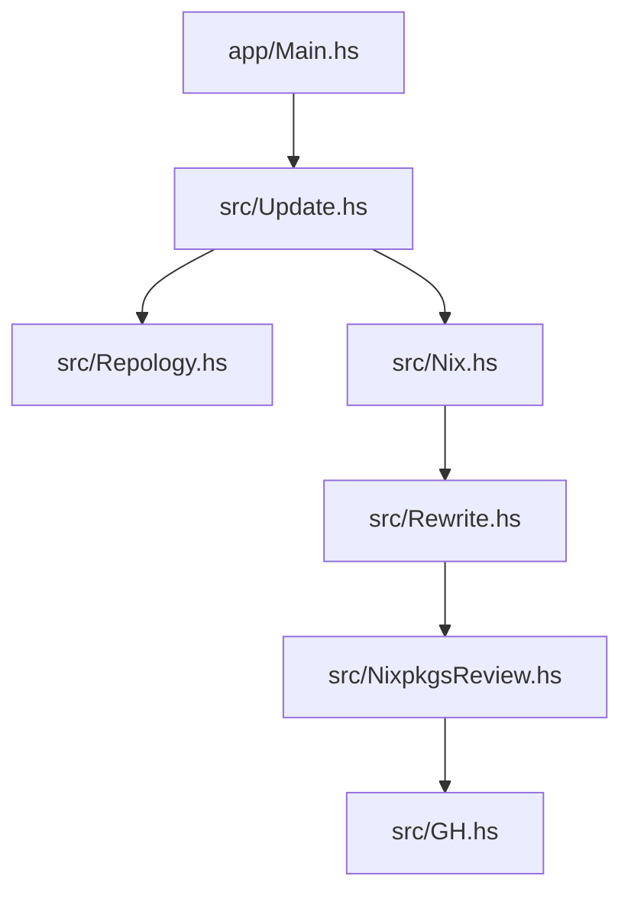

# nix-community/nixpkgs-update

> Bot that automatically updates nixpkgs packages and opens pull requests, for Nix maintainers.

## The problem
Keeping thousands of Nix packages up to date by hand is endless.

## What it actually does
The README is a single line ("read the documentation"). From the code: `Update.hs` queries Repology to detect new versions, skips packages on the Skiplist, rewrites Nix expressions with `Rewrite.hs`, verifies, runs nixpkgs-review, pushes via `Git.hs` and opens the PR via `GH.hs`, with CVEs from NVD in the description.

## How it is wired

## Trying it
No command documented in the README: everything is deferred to the external documentation.

## Cost and gotchas
Free, but Haskell and a Nix environment are required. Depends on Repology and NVD.

## What it is not
Not a general-purpose dependency update tool: it targets nixpkgs. The README does not let you use it on its own. Same repository as NixOS/nixpkgs-update (same stars and date).

## Alternatives
No alternative named in the README.

## For you
Worth watching only: interesting if you maintain Nix, with no link to a daily data / AI routine.
