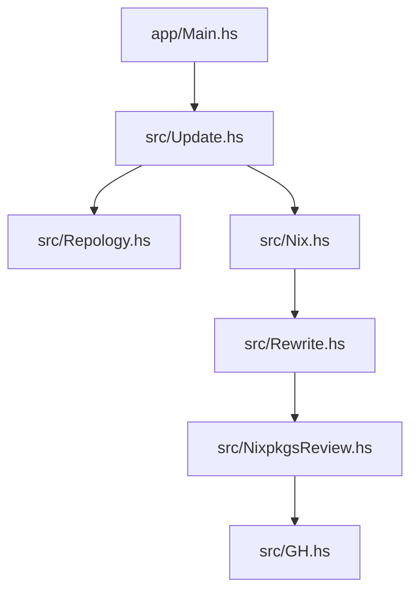

# nix-community/nixpkgs-update

> Bot qui met à jour automatiquement les paquets de nixpkgs et ouvre les pull requests, pour les mainteneurs Nix.

## Le problème
Garder des milliers de paquets Nix à jour à la main est interminable.

## Ce que ça fait vraiment
Le README tient en une ligne (« lisez la documentation »). D'après le code : `Update.hs` interroge Repology pour détecter les nouvelles versions, saute les paquets de la Skiplist, réécrit les expressions Nix avec `Rewrite.hs`, vérifie, lance nixpkgs-review, pousse via `Git.hs` et ouvre la PR via `GH.hs`, avec les CVE de NVD dans la description.

## Comment c'est branché

## Essayer
Aucune commande documentée dans le README : tout est renvoyé vers la documentation externe.

## Coût et pièges
Gratuit, mais Haskell et un environnement Nix sont nécessaires. Dépend de Repology et de NVD.

## Ce que ce n'est pas
Ce n'est pas un outil généraliste de mise à jour de dépendances : il vise nixpkgs. Le README ne permet pas de l'utiliser seul. Même dépôt que NixOS/nixpkgs-update (mêmes étoiles et date).

## Alternatives
Aucune alternative nommée dans le README.

## Pour toi
À surveiller seulement : intéressant si tu maintiens du Nix, sans lien avec un quotidien data / IA.

