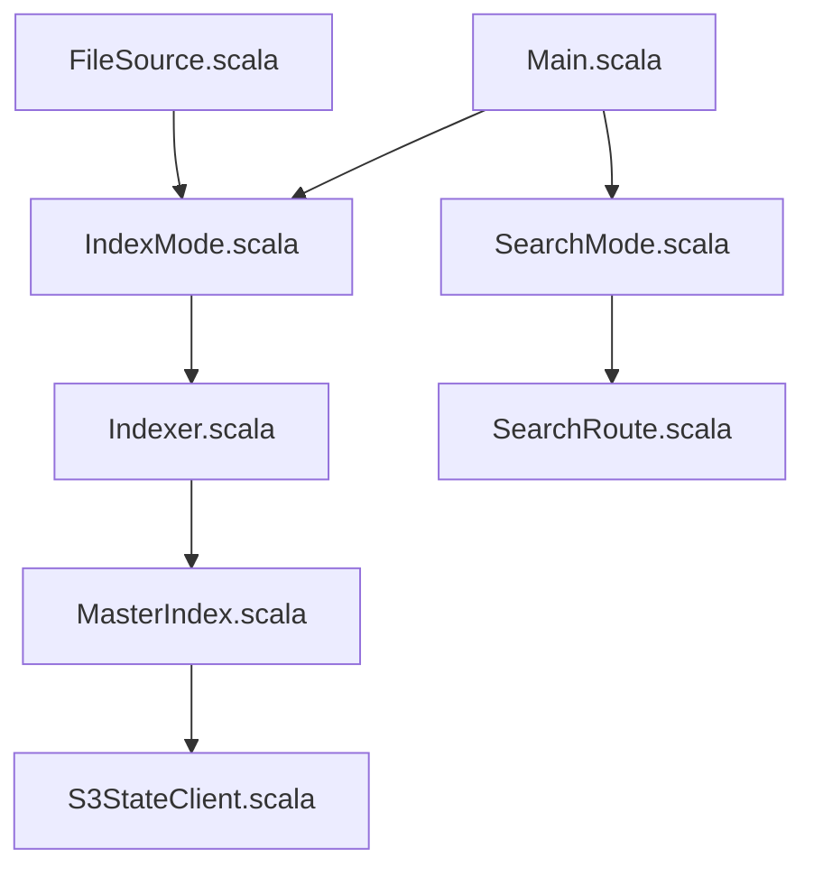

# nixiesearch/nixiesearch

> Lucene-based search engine with S3 storage and local embeddings, for relevance-oriented applications.

## The problem
Elasticsearch / OpenSearch clusters are costly and fragile to operate, especially for hybrid search.

## What it actually does
Lucene index stored on S3, stateless nodes. Lexical and vector search (local ONNX embeddings, SBERT-compatible models) with RRF fusion, facets, autocomplete, RAG API. Indexing is done by file or Kafka. Deployment on Docker, Kubernetes or AWS Lambda.

## How it is wired


## Trying it
```bash
curl -Lo movies.jsonl https://nixiesearch.ai/data/movies.jsonl
docker run -itp 8080:8080 -v .:/data nixiesearch/nixiesearch:latest standalone -c /data/config.yml
curl -XPOST -d @movies.jsonl http://localhost:8080/v1/index/movies
```

## Cost and gotchas
Free, no paid offering. Docker required; S3 storage for the decentralized mode. Last push in January 2026.

## What it is not
It is not a database, nor a log search tool, nor meant for unstructured data (the README points to ELK, Quickwit, Elastic).

## Alternatives
- Elastic / OpenSearch: preferable for unstructured data.
- Quickwit: better suited to log search.

## For you
Worth watching: hybrid search with built-in local embeddings and RAG speaks to an AI profile, to be tested on a small corpus.
