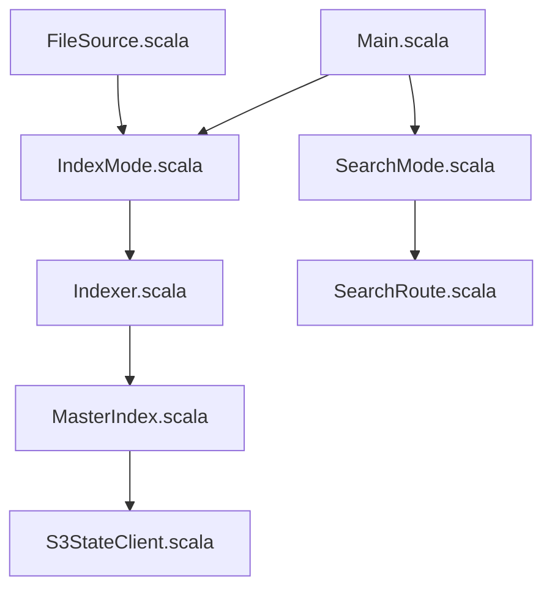

# nixiesearch/nixiesearch

> Moteur de recherche sur Lucene, avec stockage S3 et embeddings locaux, pour applications orientées pertinence.

## Le problème
Les clusters Elasticsearch / OpenSearch sont coûteux et fragiles à exploiter, surtout pour la recherche hybride.

## Ce que ça fait vraiment
Index Lucene stocké sur S3, nœuds sans état. Recherche lexicale et vectorielle (embeddings ONNX locaux, modèles compatibles SBERT) avec fusion RRF, facettes, autocomplétion, API RAG. L'indexation se fait par fichier ou Kafka. Déploiement Docker, Kubernetes ou AWS Lambda.

## Comment c'est branché


## Essayer
```bash
curl -Lo movies.jsonl https://nixiesearch.ai/data/movies.jsonl
docker run -itp 8080:8080 -v .:/data nixiesearch/nixiesearch:latest standalone -c /data/config.yml
curl -XPOST -d @movies.jsonl http://localhost:8080/v1/index/movies
```

## Coût et pièges
Gratuit, sans offre payante. Docker requis ; un stockage S3 pour le mode décentralisé. Dernier push en janvier 2026.

## Ce que ce n'est pas
Ce n'est pas une base de données, ni un outil de recherche de logs, ni fait pour des données non structurées (le README renvoie vers ELK, Quickwit, Elastic).

## Alternatives
- Elastic / OpenSearch : à préférer pour des données non structurées.
- Quickwit : mieux adapté à la recherche de logs.

## Pour toi
À surveiller : la recherche hybride avec embeddings locaux et RAG intégrés parle à un profil IA, à tester sur un petit corpus.

