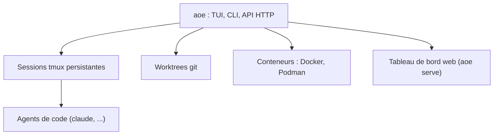

# njbrake/agent-of-empires

> tmux session manager for running code agents in parallel, with git worktrees and containers.

## The problem
Running several code agents on different branches quickly becomes unmanageable: sessions are lost when the terminal closes, and branches conflict.

## What it actually does
Each agent runs in its own persistent tmux session. The tool adds state detection, notifications, management of git worktrees and multi-repo workspaces, isolation via Docker, Podman or Apple Containers, a web dashboard (mobile access) and a diff viewer. Surfaces: TUI, web, CLI, HTTP API.

## How it is wired
Simplified diagram based on the sheet, no diagram provided.



## Trying it
```bash
brew install aoe
aoe
aoe add --cmd claude
aoe serve
```
Alternative: the repository's `scripts/install.sh` script.

## Cost and gotchas
Free. Requires tmux (Linux or macOS); Windows only via WSL2. Docker is optional, for isolation. The agents themselves have their own cost.

## What it is not
Not an agent: it drives existing agents. It is not just plain tmux, but you can still attach to a session with `tmux attach`.

## Alternatives
- No alternative named in the README.

## For you
Worth adopting on a trial basis if you run several code agents: persistent sessions and worktrees keep you from losing work, with no account or key required.
